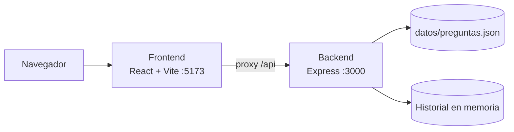
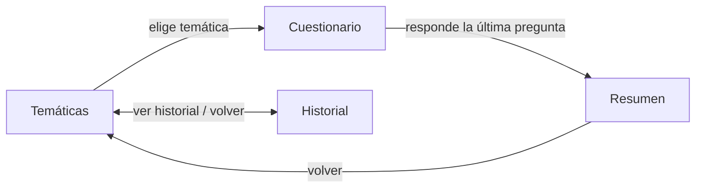

# Proyecto EduQuest G1.1

Proyecto de desarrollo de la asignatura GPI1. EduQuest es una aplicación de cuestionarios por temáticas: el usuario elige una temática, responde a sus preguntas, recibe la corrección con su nota y puede consultar su historial y sus estadísticas.

## Requisitos

- Node.js 20 o superior.
- npm.

## Inicio rápido

Desde la raíz del repositorio, con solo Node.js instalado:

```bash
npm start
```

Este comando instala o actualiza las dependencias de la raíz, `backend` y `frontend`, y después levanta los dos servidores en modo desarrollo en la misma terminal, con la salida de cada uno etiquetada como `[backend]` o `[frontend]`:

- Backend: `http://localhost:3000`
- Frontend: `http://localhost:5173`

Pulsa `Ctrl+C` para detener los dos a la vez. Si uno de ellos se detiene de forma inesperada, el otro también se detiene. Se puede volver a ejecutar en cualquier momento, por ejemplo después de cambiar de rama, para sincronizar las dependencias con los `package-lock.json`.

### Ejecución por separado

Si prefieres instalar y lanzar cada aplicación en su propia terminal:

```bash
npm install            # en la raíz, activa los hooks de Husky

cd backend
npm install
npm run dev            # o npm start, sin reinicio automático

cd frontend
npm install
npm run dev
```

## Configuración

| Elemento     | Dónde                     | Valor por defecto       | Descripción                                                                                                                            |
| :----------- | :------------------------ | :---------------------- | :------------------------------------------------------------------------------------------------------------------------------------- |
| `PUERTO`     | Variable de entorno       | `3000`                  | Puerto en el que escucha el backend.                                                                                                   |
| Proxy `/api` | `frontend/vite.config.js` | `http://localhost:3000` | En desarrollo, Vite reenvía al backend todas las peticiones que empiezan por `/api`, así que el frontend usa rutas relativas sin CORS. |

Si cambias `PUERTO`, actualiza también el `target` del proxy en `frontend/vite.config.js`.

## Otros comandos

| Ubicación  | Comando                | Qué hace                                             |
| :--------- | :--------------------- | :--------------------------------------------------- |
| Raíz       | `npm run lint`         | Ejecuta ESLint en frontend y backend.                |
| Raíz       | `npm run format`       | Aplica Prettier a frontend y backend.                |
| Raíz       | `npm run format:check` | Comprueba el formato sin modificar archivos.         |
| `frontend` | `npm run build`        | Genera la versión de producción en `frontend/dist/`. |
| `frontend` | `npm run preview`      | Sirve localmente la versión generada con `build`.    |

`backend` y `frontend` también tienen sus propios `lint`, `format` y `format:check`.

## Calidad y formato del código

- **ESLint** detecta errores en cada aplicación y **Prettier** impone el formato, con `eslint-config-prettier` para que no choquen. La configuración de `.prettierrc.json` respeta el estilo de cada aplicación: el backend con punto y coma y sin comas finales, el frontend sin punto y coma y con comas finales. Ambas usan comillas simples, 2 espacios de sangría y un ancho de 100 columnas. `backend/datos/` queda excluido del formateo.
- **Hooks de Husky** (se activan al ejecutar `npm install` en la raíz):
  - `pre-commit`: valida el nombre de la rama (`scripts/validarRama.js`), ejecuta ESLint en las dos aplicaciones y comprueba el formato.
  - `commit-msg`: valida el formato del mensaje de commit (`scripts/validarMensajeCommit.js`).
- **GitHub Actions** (`.github/workflows/ci.yml`, Node.js 20): se ejecuta en cada pull request y en cada push a `main`. Lanza en paralelo tres jobs: `lint (frontend)` y `lint (backend)` ejecutan `lint` y `format:check` en cada aplicación, y `build (frontend)` compila el frontend. Una pull request no puede fusionarse hasta que el workflow termine en verde.

Las convenciones de ramas y commits que validan los hooks están en `CONTRIBUTING.md`.

## Arquitectura base

EduQuest está dividido en dos aplicaciones independientes que se ejecutan como procesos separados: un backend en Node.js con Express que sirve la API y los datos, y un frontend en React con Vite que consume esa API.



### Estructura de carpetas

```text
g1.1/
├── backend/
│   ├── index.js                servidor Express y endpoints de la API
│   └── datos/
│       └── preguntas.json      temáticas y preguntas
├── frontend/
│   ├── vite.config.js          configuración de Vite y proxy /api
│   ├── public/
│   │   └── tematicas/          logos de las temáticas
│   └── src/
│       ├── main.jsx            punto de entrada (importa las fuentes y index.css)
│       ├── App.jsx             cambia entre la selección de temáticas y el historial
│       ├── components/         un .jsx y un .css por componente
│       ├── utils.js            funciones de formato compartidas
│       ├── index.css           reset, variables globales y botones compartidos
│       └── vistaDiseno.css     variables del diseño "Cognitive Clarity"
├── scripts/                    arranque único y validadores de los hooks
├── .github/                    workflow de CI y plantilla de pull request
├── .husky/                     hooks de Git
├── CONTRIBUTING.md             convenciones del proyecto
└── sprint-backlog-eduquest.xlsx  product backlog, seguimiento de sprints y retrospectiva
```

### Backend

El punto de entrada es `backend/index.js`. Las temáticas y sus preguntas se leen de `backend/datos/preguntas.json`; cada pregunta tiene un `id`, un `enunciado`, cuatro `opciones` y el índice de la `respuestaCorrecta`.

| Método | Ruta             | Parámetros                                                           |
| :----- | :--------------- | :------------------------------------------------------------------- |
| GET    | `/api/tematicas` | —                                                                    |
| GET    | `/api/preguntas` | Query `id` o `tematica` (nombre, sin distinguir mayúsculas)          |
| POST   | `/api/corregir`  | Body `{ tematicaId, respuestas: [{ idPregunta, indiceRespuesta }] }` |
| GET    | `/api/historial` | —                                                                    |
| GET    | `/api/mensajes`  | —                                                                    |

Cuando una petición falla, la respuesta lleva el código de error HTTP y un cuerpo con el motivo, por ejemplo `{ "error": "La tematica solicitada no existe" }`.

#### `GET /api/tematicas`

Devuelve todas las temáticas, sin sus preguntas.

```json
[
  {
    "id": "cat-filosofia",
    "nombre": "Filosofía",
    "descripcion": "Preguntas sobre historia de la filosofía, autores y corrientes de pensamiento",
    "logo": "/tematicas/filosofia.svg"
  }
]
```

#### `GET /api/preguntas?id=cat-filosofia`

Devuelve 5 preguntas de la temática al azar (todas si tiene menos), sin `respuestaCorrecta` para que el cliente no pueda ver la solución. En el ejemplo se muestra solo la primera. Si la temática no existe responde `404`.

```json
[
  {
    "id": "preg-fil-01",
    "enunciado": "¿Qué filósofo propuso el método dialéctico basado en preguntas sucesivas conocido como mayéutica?",
    "opciones": ["Sócrates", "Platón", "Aristóteles", "Heráclito"]
  }
]
```

#### `POST /api/corregir`

Corrige las respuestas y registra la partida en el historial. Cada respuesta indica la pregunta y el índice de la opción elegida (de 0 a 3). Ejemplo de cuerpo:

```json
{
  "tematicaId": "cat-filosofia",
  "respuestas": [
    { "idPregunta": "preg-fil-01", "indiceRespuesta": 0 },
    { "idPregunta": "preg-fil-02", "indiceRespuesta": 2 }
  ]
}
```

Respuesta (en el ejemplo, el detalle de solo dos preguntas):

```json
{
  "aciertos": 4,
  "fallos": 1,
  "nota": 8,
  "detalle": [
    {
      "idPregunta": "preg-fil-01",
      "respuestaSeleccionada": 0,
      "respuestaCorrecta": 0,
      "esCorrecta": true
    },
    {
      "idPregunta": "preg-fil-02",
      "respuestaSeleccionada": 2,
      "respuestaCorrecta": 0,
      "esCorrecta": false
    }
  ]
}
```

La `nota` es sobre 10 con un decimal. Responde `400` si el cuerpo no es válido, el número de respuestas no coincide con las preguntas del cuestionario (5, o todas las de la temática si tiene menos), hay preguntas repetidas o algún índice no es un entero entre 0 y 3, y `404` si no existe la temática o alguna pregunta.

#### `GET /api/historial`

Devuelve las partidas corregidas en orden cronológico ascendente y las estadísticas por temática (`totalTests` y `notaMedia`). Con el historial vacío, los dos arrays llegan vacíos.

```json
{
  "historial": [
    {
      "id": "hist-1",
      "fecha": "2026-10-16T10:30:00.000Z",
      "tematicaId": "cat-filosofia",
      "tematicaNombre": "Filosofía",
      "aciertos": 4,
      "total": 5,
      "nota": 8
    }
  ],
  "estadisticas": [
    {
      "tematicaId": "cat-filosofia",
      "tematicaNombre": "Filosofía",
      "totalTests": 3,
      "notaMedia": 7.3
    }
  ]
}
```

El historial se guarda en un array en memoria del backend. Es volátil (se pierde al reiniciar el servidor) y compartido por todos los clientes, por lo que las estadísticas agregan las partidas de todos los usuarios.

#### `GET /api/mensajes`

Sirve para comprobar que el backend responde; el frontend no lo usa.

```json
{
  "estado": "conectado",
  "mensaje": "Servidor backend conectado exitosamente con el frontend",
  "marcaTiempo": "2026-10-16T10:30:00.000Z"
}
```

### Frontend

La aplicación tiene cuatro pantallas. Así se pasa de una a otra:



| Pantalla     | Componente principal  | Qué muestra                                                   | Componentes hijos                                                                      |
| :----------- | :-------------------- | :------------------------------------------------------------ | :------------------------------------------------------------------------------------- |
| Temáticas    | `SeleccionTematica`   | Una tarjeta por temática y el botón para ver el historial     | `Encabezado`, `TarjetaTematica`, `AccesoHistorial`                                     |
| Cuestionario | `PantallaPregunta`    | Una pregunta cada vez con su progreso                         | `ProgresoCuestionario`, `TarjetaPregunta` (con `OpcionRespuesta`), `ControlesPregunta` |
| Resumen      | `ResumenCuestionario` | La nota, los aciertos y fallos, y el detalle de cada pregunta | `DetallePregunta`                                                                      |
| Historial    | `PanelHistorial`      | Resumen de partidas, dos gráficos y las últimas partidas      | `Encabezado`, `EvolucionHistorial` (líneas), `EstadisticasCategorias` (barras)         |

- **Navegación:** no hay librería de rutas; `App.jsx` cambia entre temáticas e historial con un estado, y el cuestionario y el resumen se muestran dentro de la pantalla de temáticas.
- **Utilidades compartidas (`src/utils.js`):** `formatearNota`, `formatearFecha` y `obtenerClaseNota` (color de la nota), para que una misma nota se vea igual en el resumen, el historial y los gráficos.

### Dependencias

| Aplicación | Dependencia                                                 | Uso                                           |
| :--------- | :---------------------------------------------------------- | :-------------------------------------------- |
| Backend    | `express`                                                   | Servidor HTTP y API.                          |
| Backend    | `cors`                                                      | Permite peticiones desde otro origen.         |
| Backend    | `nodemon` (desarrollo)                                      | Reinicio automático con `npm run dev`.        |
| Frontend   | `react`, `react-dom`                                        | Interfaz de usuario.                          |
| Frontend   | `vite` (desarrollo)                                         | Servidor de desarrollo, proxy `/api` y build. |
| Frontend   | `recharts`                                                  | Gráficos del historial.                       |
| Frontend   | `@fontsource/hanken-grotesk`, `@fontsource/space-grotesk`   | Fuentes servidas desde el propio proyecto.    |
| Ambas      | `eslint`, `prettier`, `eslint-config-prettier` (desarrollo) | Calidad y formato del código.                 |
| Raíz       | `husky` (desarrollo)                                        | Hooks de Git.                                 |

### Decisiones técnicas

- **Historial en memoria:** no hay base de datos todavía; el historial se guarda en un array del backend para poder construir el panel sin añadir infraestructura. Por eso es volátil y compartido entre usuarios.
- **5 preguntas aleatorias por cuestionario:** la constante `PREGUNTAS_POR_CUESTIONARIO` de `backend/index.js` fija cuántas preguntas sirve `GET /api/preguntas` y cuántas respuestas exige `POST /api/corregir`. Así cada partida es distinta aunque se repita la temática, y una temática puede tener más preguntas en `preguntas.json` sin dejar de poder corregirse. El backend nunca envía la respuesta correcta al cliente, solo en la corrección.
- **Proxy de Vite en lugar de URLs absolutas:** el frontend llama a `/api/...` y Vite lo reenvía al backend, así no hay que configurar la URL del backend en el cliente.
- **Navegación con estado, sin router:** solo hay dos vistas, así que un estado en `App.jsx` es suficiente.
- **Máximo de 10 partidas recientes:** el historial no está paginado y crece con cada cuestionario, así que el panel limita la lista (`MAXIMO_PARTIDAS_RECIENTES` en `PanelHistorial.jsx`).
- **Un CSS por componente:** cada componente lleva sus estilos y media queries, y los colores repetidos se centralizan en variables globales para no duplicar valores.
- **Variables de "Cognitive Clarity" con ámbito en `.vista-diseno`:** así el nuevo diseño se aplica solo a temáticas e historial sin cambiar el resto de pantallas.
- **Fuentes locales con `@fontsource`:** evitan peticiones a servicios externos.
- **Etiquetas de los gráficos en varias líneas:** el texto SVG no hace saltos de línea, así que los nombres largos de las temáticas se dividen para que no se solapen en móvil.
- **Arranque único sin dependencias (`scripts/iniciar.js`):** funciona en un clon recién hecho antes de instalar nada. Al terminar detiene ambos servidores (en Windows con `taskkill /T` y en macOS/Linux con grupos de procesos) para no dejar puertos ocupados.
- **Migración de GitLab a GitHub:** el repositorio, las issues, las etiquetas y los milestones se trasladaron a GitHub conservando la numeración de las issues, para que las referencias `#N` de los commits sigan siendo válidas. El pipeline de GitLab CI se sustituyó por un workflow de GitHub Actions con los mismos pasos, y la rama `main` está protegida: exige pull request con una aprobación y el CI en verde.

## Flujo de contribución

El repositorio está alojado en GitHub: https://github.com/irigoyen161817/g1.1. Las ramas, commits y pull requests deben seguir las reglas definidas en `CONTRIBUTING.md`. Todo cambio debe revisarse mediante una pull request antes de incorporarse a `main`.
